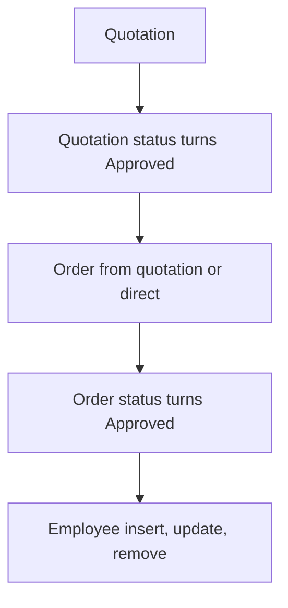

# Quotation & Order Flow

App baseline: what the Neome App gives out of the box, learnt from NA-quotation-and-order-flow.

## Gives

- Master sheets for employee, product category, unit, product, customer, shipping method, payment terms.
- Master data menu screen opens the masters.
- Quotation with customer, shipping, payment terms, product grid, discount, tax, totals.
- Manager approves or rejects quotation; approved gets PDF and message to creator.
- Order from a quotation or direct, with same grid and totals.
- Order approval makes order PDF and messages creator.
- Employee row creates and manages app user.
- Quotation dashboard by date range.

## Sheets, key fields, roles

- Customer: CompanyName, ContactPerson, ContactNumber, GSTIN, BillingAddress, ShippingAddress
- Product: ProductName, Price, GST, Category →ProductCategory, Unit →UnitOfMeasurement
- Quotation: Customer →Customer, ShippingMethod →ShippingMethod, PaymentTerms →PaymentTerms, Status {Pending|Approved|Rejected}, OrderGiven {Yes|No}, Products grid, totals
- Order: OrderType {Quotation|Direct Order}, Quotation →Quotation, Customer →Customer, Status {Pending|Approved|Rejected}, Products grid, totals
- Employee: Employee user, Manager, Roles, Status
- Roles: SalesExecutive, SalesManager, Finance, OrganizationAdmin.

## Workflows

- Quotation: product grid with discount, tax and totals.
- Quotation status turns Approved: PDF made and stored; creator messaged.
- Order from quotation or direct: quotation row updated when from a quotation.
- Order status turns Approved: order PDF made; creator messaged.
- Employee insert, update, remove: app user kept in step with the row.

## Flowchart

