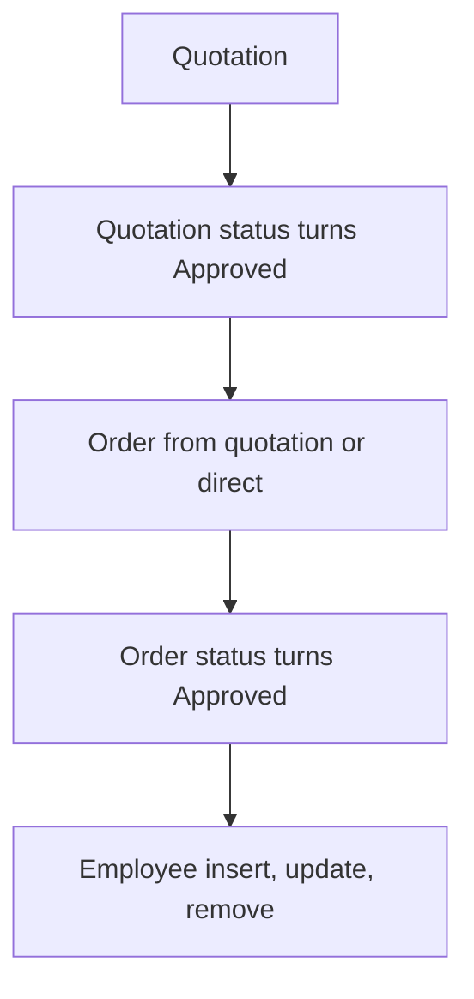

# Quotation & Order Flow

App baseline: what the Neome App gives out of the box, learnt from NA-quotation-and-order-flow.

## Gives

- Master sheets for employee, product category, unit, product, customer, shipping method, payment terms.
- Master data menu screen opens the masters.
- Quotation with customer, shipping, payment terms, product grid, discount, tax, totals.
- Manager approves or rejects quotation; approved gets PDF and message to creator.
- Order from a quotation or direct, with same grid and totals.
- Order approval makes order PDF and messages creator.
- Employee row creates and manages app user.
- Quotation dashboard by date range.

## Sheets, key fields, roles

- Customer: CompanyName, ContactPerson, ContactNumber, GSTIN, BillingAddress, ShippingAddress
- Product: ProductName, Price, GST, Category →ProductCategory, Unit →UnitOfMeasurement
- Quotation: Customer →Customer, ShippingMethod →ShippingMethod, PaymentTerms →PaymentTerms, Status {Pending|Approved|Rejected}, OrderGiven {Yes|No}, Products grid, totals
- Order: OrderType {Quotation|Direct Order}, Quotation →Quotation, Customer →Customer, Status {Pending|Approved|Rejected}, Products grid, totals
- Employee: Employee user, Manager, Roles, Status
- Roles: SalesExecutive, SalesManager, Finance, OrganizationAdmin.

## Workflows

- Quotation: product grid with discount, tax and totals.
- Quotation status turns Approved: PDF made and stored; creator messaged.
- Order from quotation or direct: quotation row updated when from a quotation.
- Order status turns Approved: order PDF made; creator messaged.
- Employee insert, update, remove: app user kept in step with the row.

## Flowchart

## Execute

Only use this to apply this into a Studio Enterprise via MCP.

Only if Neome App quotation-and-order-flow is not installed (check `list` first): rebuild what Gives lists. If installed, reuse it and build only gaps. Placeholders: ProductCategory, UnitOfMeasurement, Product, Customer, ShippingMethod, PaymentTerms, Quotation, Order, Employee, roles SalesExecutive, SalesManager, Finance, OrganizationAdmin. Needs first: none.

1. Roles + vars: `add kind=role` x4; `add kind=var kind=setOfText` Status {Pending|Approved|Rejected}, OrderGiven {Yes|No}, OrderType {Quotation|Direct Order}.
2. Masters: ProductCategory, UnitOfMeasurement, ShippingMethod, PaymentTerms: `apply PAT-admin-kept-pick-list Execute`; Customer (CompanyName, ContactPerson, ContactNumber, GSTIN, BillingAddress, ShippingAddress) and Product (ProductName, `type=decimal` Price, GST, `type=ref` Category, `type=ref` Unit) → sheets with list layouts.
3. Masters menu: `apply PAT-action-set-menu Execute`.
4. Quotation: `type=ref` Customer, ShippingMethod, PaymentTerms (`copyFieldMap`), `type=pickText` Status, OrderGiven; `kind=composite type=grid` Products → `type=ref` Product + Qty, Rate, Discount, Tax, Amount (`apply PAT-line-items-grid-with-totals Execute`) → `QuotationSheet` (insert [SalesExecutive], update [SalesManager, Finance]) → table layout. Approved → PDF + message to creator: `apply PAT-approval-by-status Execute` + `apply PAT-pdf-from-report Execute` + `apply PAT-message-on-event Execute`.
5. Order: `type=pickText` OrderType, `type=ref` Quotation, `type=ref` Customer, same grid + totals → `OrderSheet` → table layout. From a quotation: `apply PAT-order-from-quote-or-direct Execute`; direct order skips the quote ref.
6. Order approval: same approve → PDF + message pattern on OrderSheet.
7. Employee: form + sheet with Employee user, Manager, Roles, Status → `apply PAT-sheet-row-drives-app-user Execute`.
8. Quotation dashboard: `apply PAT-query-report-with-filter Execute` (dateRange input) + `apply PAT-composite-report Execute`.
9. Actions + group: per-sheet actions + `kind=report` → `set kind=group actionPermissionMap` (roles on every entry). `validate` till ok=true.

Gaps: quote grid → order grid fill (verify: describe); totals mapping across forms; edgeMap entry keys unverified.
