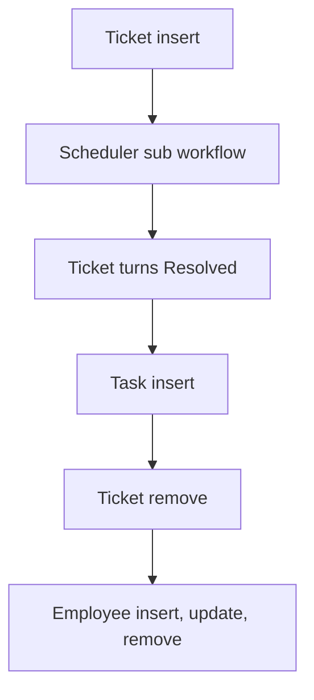

# Ticketing & Task Management

App baseline: what the Neome App gives out of the box, learnt from NA-ticketing-and-task-management.

## Gives

- Admin keeps ticket categories with SLA hours, priorities, customers and staff.
- Support raises tickets with customer, category, priority and assignee.
- Ticket SLA due time and resolution hours are worked out by formula.
- Assignee is messaged on open tickets; escalation goes to the creator.
- Tasks are added under a ticket and carry ticket details.
- Monthly dashboard of total tickets, tasks and SLA breaches.
- Staff row adds, updates and removes the app user.

## Sheets, key fields, roles

- Ticket: Customer →Customer, Category →TicketCategory, Priority →TicketPriority, AssignedTo @SupportExecutive, Status {New|Open|In Progress|Pending|On Hold|Resolved|Closed|Reopened}, SLADueDate, ResolutionHours
- Task: Ticket →Ticket, AssignedTo @SupportExecutive, DueDate, TaskStatus {Open|In Progress|On Hold|Pending|Completed|Closed|Reopened|Cancelled}
- TicketCategory: TicketCategory, SLAHours
- TicketPriority: TicketPriority, ResponseTime
- Customer: CustomerName, GSTIN, PAN, Status
- Employee: EmployeeName, Roles, Manager, Status
- Roles: SupportExecutive, SupportManager, DepartmentManager, OrganizationAdmin.

## Workflows

- Ticket insert: SLA due time from category; per-row scheduler starts.
- Scheduler sub workflow: assignee messaged while open; escalation to the creator.
- Ticket turns Resolved: resolution hours set on the row.
- Task insert: carries ticket details; ticket row updated.
- Ticket remove: its scheduler removed.
- Employee insert, update, remove: app user kept in step with the row.

## Flowchart

## Execute

Only use this to apply this into a Studio Enterprise via MCP.

Only if Neome App ticketing-and-task-management is not installed (check `list` first): rebuild what Gives lists. If installed, reuse it and build only gaps. Placeholders: Ticket, Task, TicketCategory, TicketPriority, Customer, Employee, roles SupportExecutive, SupportManager, DepartmentManager, OrganizationAdmin. Needs first: none.

1. Roles + vars: `add kind=role` x4; `add kind=var kind=setOfText` TicketStatus, TaskStatus.
2. Masters: Customer (CustomerName, GSTIN, PAN, Status) → CustomerSheet; TicketCategory (TicketCategory, `type=number` SLAHours); TicketPriority (TicketPriority, ResponseTime): `apply PAT-admin-kept-pick-list Execute`.
3. Ticket: `type=ref` Customer, `type=ref` Category (`copyFieldMap` copies SLAHours), `type=ref` Priority, `type=pickUser` AssignedTo (`roleIdDataSource=[SupportExecutive]`), `type=pickText` Status, `type=dateTime` SLADueDate (`disabled=true`), `type=number` ResolutionHours (`disabled=true`) → `TicketSheet` (insert [SupportExecutive]) → table layout.
4. SLA due time: `apply PAT-calculated-field Execute` (created + category SLAHours). Resolved: `eventSsUpdateAfter` → applyFormula sets ResolutionHours → `rowUpdate`.
5. Reminders + escalation: `apply PAT-per-row-scheduler Execute` (schedulerId + next run on the ticket); run the job body as a sub workflow (`apply PAT-shared-sub-workflow Execute`) — assignee messaged while open (`apply PAT-message-on-event Execute`), creator on breach.
6. Ticket remove: same pattern's clear path (`executeSchedulerRemove`).
7. Task: `type=ref` Ticket (`copyFieldMap` carries ticket details), `type=pickUser` AssignedTo, `type=date` DueDate, `type=pickText` TaskStatus → `TaskSheet` → table layout; insert updates the ticket row (`apply PAT-update-linked-rows Execute`).
8. Employee: form + sheet with EmployeeName, Roles, Manager, Status → `apply PAT-sheet-row-drives-app-user Execute`.
9. Monthly dashboard: `apply PAT-query-report-with-filter Execute` (total tickets, tasks, SLA breaches) + `apply PAT-composite-report Execute`; actions → `set kind=group actionPermissionMap`.
10. `validate` till ok=true.

Gaps: per-row scheduler shape (verify: describe); escalation timing rule; edgeMap entry keys unverified.
