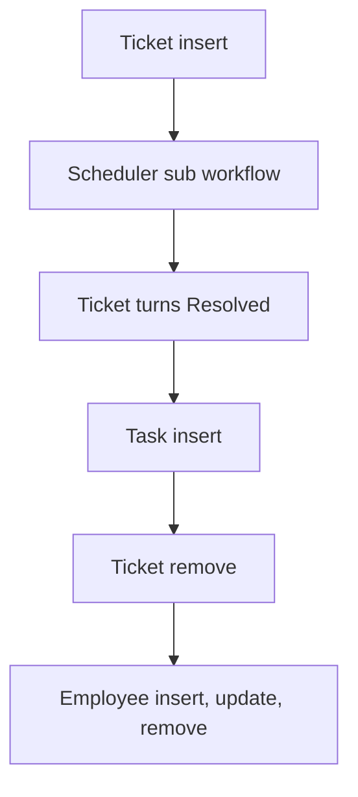

# Ticketing & Task Management

App baseline: what the Neome App gives out of the box, learnt from NA-ticketing-and-task-management.

## Gives

- Admin keeps ticket categories with SLA hours, priorities, customers and staff.
- Support raises tickets with customer, category, priority and assignee.
- Ticket SLA due time and resolution hours are worked out by formula.
- Assignee is messaged on open tickets; escalation goes to the creator.
- Tasks are added under a ticket and carry ticket details.
- Monthly dashboard of total tickets, tasks and SLA breaches.
- Staff row adds, updates and removes the app user.

## Sheets, key fields, roles

- Ticket: Customer →Customer, Category →TicketCategory, Priority →TicketPriority, AssignedTo @SupportExecutive, Status {New|Open|In Progress|Pending|On Hold|Resolved|Closed|Reopened}, SLADueDate, ResolutionHours
- Task: Ticket →Ticket, AssignedTo @SupportExecutive, DueDate, TaskStatus {Open|In Progress|On Hold|Pending|Completed|Closed|Reopened|Cancelled}
- TicketCategory: TicketCategory, SLAHours
- TicketPriority: TicketPriority, ResponseTime
- Customer: CustomerName, GSTIN, PAN, Status
- Employee: EmployeeName, Roles, Manager, Status
- Roles: SupportExecutive, SupportManager, DepartmentManager, OrganizationAdmin.

## Workflows

- Ticket insert: SLA due time from category; per-row scheduler starts.
- Scheduler sub workflow: assignee messaged while open; escalation to the creator.
- Ticket turns Resolved: resolution hours set on the row.
- Task insert: carries ticket details; ticket row updated.
- Ticket remove: its scheduler removed.
- Employee insert, update, remove: app user kept in step with the row.

## Flowchart

