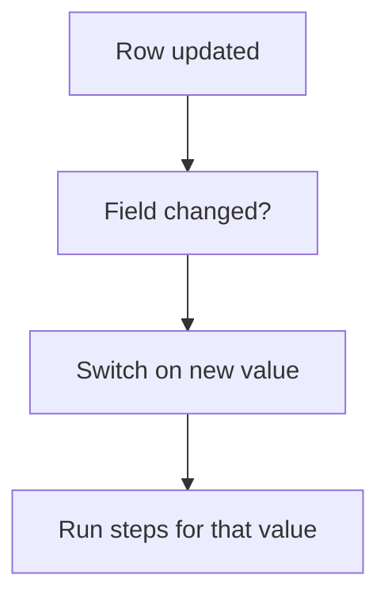

# Act on status or field change

## Task

Run steps when a status (or another key field) on a row changes.

## How

- pickText status field on the sheet.
- Workflow on update-after with a branch Curr value not equal to Prior value.
- Switch on the new value; each case runs its own steps or a sub workflow.
- Typical steps: row update on linked sheets, user update, message to the creator or a role.

## Workaround

No. Direct workflow feature.

## Limits

- Every branch must check the change itself, or saves without a change re-run the steps.
- Many cases in one switch get hard to read; sub workflows help.

## Flowchart

## Execute

Only use this to apply this into a Studio Enterprise via MCP.

Placeholders: `Thing` form, `ThingSheet`, `VarThingStatus`, `ThingStatusWf`. Needs first: the sheet.

1. Var: `add kind=var kind=setOfText name=VarThingStatus deploy=fixedOnDeploy value={"Open":{},"Done":{}}` (reuse if it exists).
2. Field: `add kind=field parent=Thing type=pickText name=Status source=VarThingStatus`. `set kind=spreadsheet ref=ThingSheet queryables` add `Status`.
3. Workflow: `add kind=workflow name=ThingStatusWf` (nodeMap, edgeMap, noteMap, regionMap = `{}`).
4. Nodes: `add kind=node kind=eventSsUpdateAfter spreadsheet=ThingSheet` → `kind=branchIfElse option=Condition condition=<$Curr Status notEqualTo $Prior Status>` (verify: describe) → `kind=branchSwitchCase field={param:"$Curr",field:"Status"}`.
5. Per value: step nodes (`rowUpdate` on linked sheet, `userUpdate`, `sendMessageToUsers`) or `executeSubWorkflow startNode=<node>` for long cases.
6. Edges: `set kind=workflow ref=ThingStatusWf edgeMap`: event → if NEXT; if → switch TRUE (FALSE = end); switch → first step VALUE `value=keyDone` (one per option key); steps NEXT.
7. `validate` till ok=true. `describe kind=workflow` to confirm edges.

Gaps: condition shape comparing `$Curr` to `$Prior` unconfirmed; edgeMap entry keys unverified.
