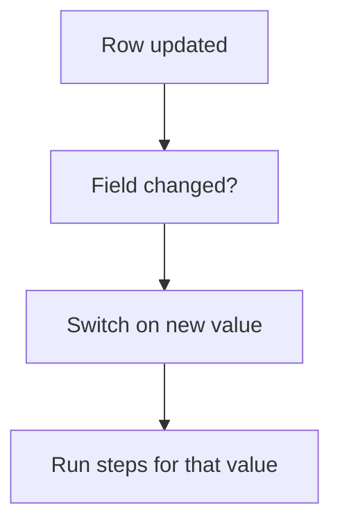

# Act on status or field change

## Task

Run steps when a status (or another key field) on a row changes.

## How

- pickText status field on the sheet.
- Workflow on update-after with a branch Curr value not equal to Prior value.
- Switch on the new value; each case runs its own steps or a sub workflow.
- Typical steps: row update on linked sheets, user update, message to the creator or a role.

## Workaround

No. Direct workflow feature.

## Limits

- Every branch must check the change itself, or saves without a change re-run the steps.
- Many cases in one switch get hard to read; sub workflows help.

## Flowchart

