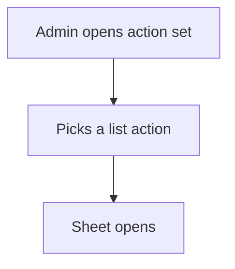

# Menu by action set

## Task

Admin opens all master lists from one place.

## How

- actionsSet action for the role that groups the list actions.

## Workaround

No. Direct feature (actionsSet).

## Limits

- Groups actions only; it cannot show counts or reports.

## Flowchart

