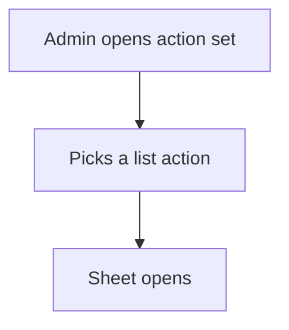

# Menu by action set

## Task

Admin opens all master lists from one place.

## How

- actionsSet action for the role that groups the list actions.

## Workaround

No. Direct feature (actionsSet).

## Limits

- Groups actions only; it cannot show counts or reports.

## Flowchart

## Execute

Only use this to apply this into a Studio Enterprise via MCP.

Placeholders: `MastersMenu`, `AdminGroup`, `Admin`. Needs first: the list actions (one `spreadsheetEditor` per master sheet, e.g. PAT-admin-kept-pick-list).

1. Action: `add kind=action kind=actionsSet name=MastersMenu actions=["TypeEditor","UnitEditor"] renderingMode=list`.
2. Group: `set kind=group ref=AdminGroup actionPermissionMap` add `{"MastersMenu":{"roles":["Admin"]}}`; keep the list actions' entries (roles on every entry).
3. `validate` till ok=true. `describe kind=group` to confirm.

Gaps: whether list actions inside the set must also sit in the group map is unverified (verify: describe).
