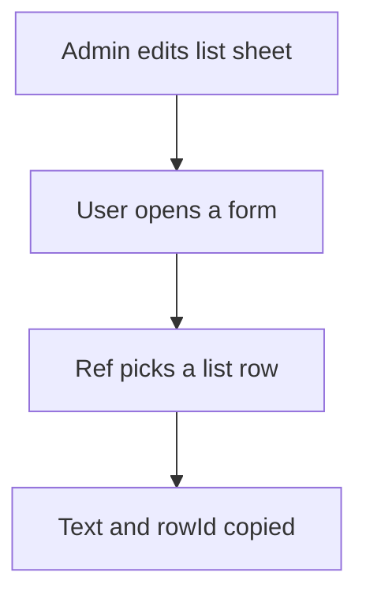

# Pick list kept by admin

## Task

Admin or HR keeps short lists (type, category, branch, unit, reason) that other sheets pick from.

## How

- One small sheet per list, often one text field.
- Insert, update and remove for Admin or HR only; others read.
- spreadsheetEditor action per list for the keeper roles.
- Other sheets pick with a ref field and copy the text and rowId.
- Two-level lists: a sub list sheet refs its parent list.

## Workaround

No. Direct feature (sheet rights plus ref).

## Limits

- Many small lists mean many sheets and actions; group them in a menu.
- A pickText field is lighter when the list never changes.

## Flowchart

