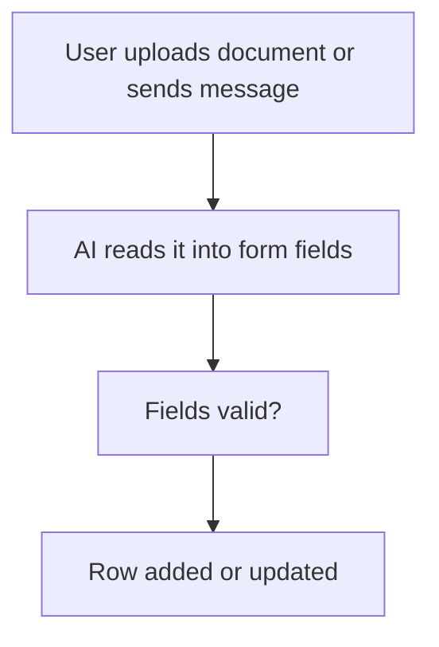

# AI reads a document or message into a form

## Task

Fill form fields from an uploaded document (visiting card, customer details, lead list) or from the text of a chat message.

## How

- Document: document field on the sheet; workflow on insert-after branches when it has a value; aiDocumentToForm.
- Message text: aiTextToForm on the message (often after a chat event).
- Branch on the read fields being valid, then rowUpdate or rowInsert (for example a new lead).

## Workaround

No. Direct feature (document to form and text to form nodes).

## Limits

- Read values need a human check.
- Bad scans or loose text leave fields empty; keep a fallback.

## Flowchart

