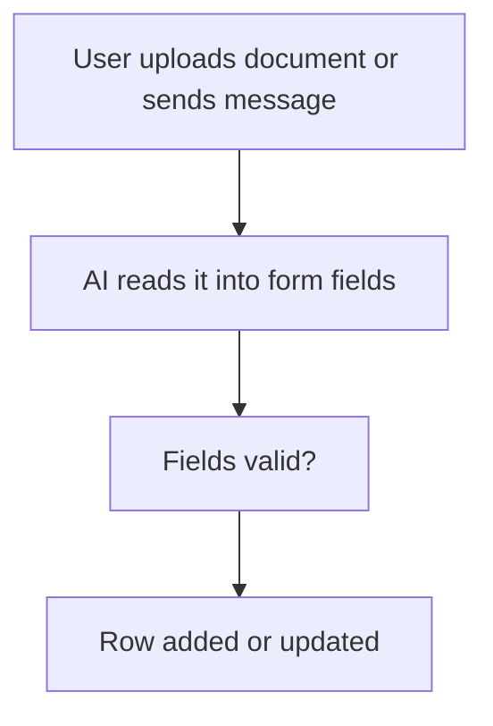

# AI reads a document or message into a form

## Task

Fill form fields from an uploaded document (visiting card, customer details, lead list) or from the text of a chat message.

## How

- Document: document field on the sheet; workflow on insert-after branches when it has a value; aiDocumentToForm.
- Message text: aiTextToForm on the message (often after a chat event).
- Branch on the read fields being valid, then rowUpdate or rowInsert (for example a new lead).

## Workaround

No. Direct feature (document to form and text to form nodes).

## Limits

- Read values need a human check.
- Bad scans or loose text leave fields empty; keep a fallback.

## Flowchart

## Execute

Only use this to apply this into a Studio Enterprise via MCP.

Placeholders: `Lead` form, `LeadSheet`, `LeadRead` output form, `LeadReadWf`. Needs first: the sheet; an AI keychain in the Enterprise.

1. Field: `add kind=field parent=Lead type=document name=Card fileTypeSet=[...]`.
2. Output form: `add kind=form name=LeadRead` → `kind=composite type=section` → fields to read (`type=text` Name, `type=mobileNumber` Mobile, `type=email` Email).
3. Workflow: `add kind=workflow name=LeadReadWf` (4 maps `{}`).
4. Document nodes: `kind=eventSsInsertAfter spreadsheet=LeadSheet` → `kind=mediaExists mediaField={param:"$Curr",field:"Card"}` → `kind=aiDocumentToForm inputField={param:"$Curr",field:"Card"} outputForm=LeadRead outputParamName=Read keychain=<name> aiProvider=openAI_5_4_MINI aiInstructions={value:"..."}`.
5. Then `kind=branchIfElse option=Condition condition=<Read.Mobile hasValue>` (verify: describe) → `kind=rowUpdate rowIdPointer={spreadsheet:"LeadSheet",row:<$Curr row id>} option=Mapping outputMapping=<Read → Lead>`.
6. Message variant: `kind=eventChat` → `kind=aiTextToForm inputField=<message text> outputForm=LeadRead` → `paramUpdate` + `rowInsert spreadsheet=LeadSheet` (insert-row pattern in guide).
7. Edges: NEXT chain; mediaExists / branchIfElse TRUE onward, FALSE end; ai node ERROR → `sendMessageToUsers` fallback.
8. `validate` till ok=true.

Gaps: keychain name per Enterprise (ask user); `mediaExists` on a document field, `$Curr` row id binder, chat message field and `outputMapping` shape unconfirmed.
