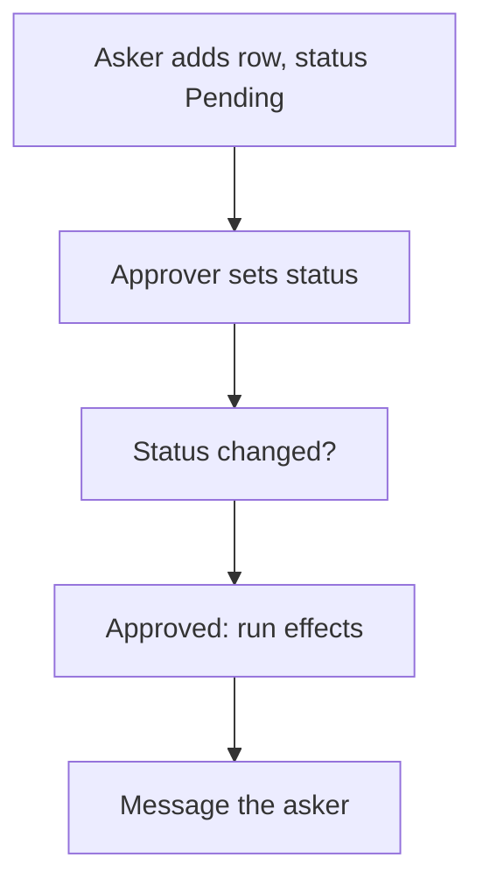

# Approval by status

## Task

An approver approves or rejects a request (leave, claim, quote, order, regularisation, balance change) before its effects run.

## How

- Status pickText such as Pending, Approved, Rejected on the sheet.
- Insert and update rights per role: askers insert, approvers update.
- Workflow on update-after: branch when the status changed and is no longer Pending, then switch on the status value.
- Approved branch runs the effects (row update, balance change, PDF); both branches message the asker.
- Often one spreadsheet action per status (pending, approved, rejected) for the approver.
- Line-wise variant: approved amount per grid line, rejected amount is the rest (workflow iterates the grid).

## Workaround

Yes. Neome has no approval step; a status list, role rights and a workflow branch stand in.

## Limits

- No built-in approver routing or escalation; the approver is a role or a pickUser field.
- Changing the status back does not undo effects unless a reverse branch is built.
- More than one level needs a status per level or a level log (see PAT-multi-level-approval).

## Flowchart

## Execute

Only use this to apply this into a Studio Enterprise via MCP.

Placeholders: `Request` form, `RequestSheet`, `RequestTable`, `VarApprovalStatus`, roles `Asker` / `Approver`, `RequestApprovalWf`, `Lines` (line-wise only). Needs first: the sheet; for step 9, a `Lines` grid on Request (e.g. PAT-line-items-grid-with-totals).

1. Var + roles: `add kind=var kind=setOfText name=VarApprovalStatus deploy=fixedOnDeploy value={"Pending":{},"Approved":{},"Rejected":{}}`; `add kind=role` Asker, Approver.
2. Field: `add kind=field parent=Request type=pickText name=Status source=VarApprovalStatus defaultOption=keyPending disabledRoles=["Asker"]`.
3. Rights: `set kind=spreadsheet ref=RequestSheet insertRoles=["Asker"] updateRoles=["Approver"] queryables` add `Status`.
4. Lists: per status `add kind=var kind=condition name=IsPending value={node:<Status equalTo keyPending>,sourceForm:"Request"}` (verify: describe) → `add kind=action kind=spreadsheetEditor name=PendingRequests spreadsheet=RequestSheet layoutSpreadsheet=RequestTable filterCondition={cond:"IsPending",negation:false}`. Same for Approved, Rejected.
5. Group: `set kind=group actionPermissionMap` each list action `{"roles":["Approver"]}`.
6. Workflow: `add kind=workflow name=RequestApprovalWf` (4 maps `{}`) → `kind=eventSsUpdateAfter spreadsheet=RequestSheet` → `kind=branchIfElse option=Condition` (Status changed and not keyPending; verify: describe) → `kind=branchSwitchCase field={param:"$Curr",field:"Status"}`.
7. Approved: effect nodes (`rowUpdate`, `generatePdf`) → `sendMessageToUsers`. Rejected: `sendMessageToUsers toUsers=<row creator>`.
8. Edges: NEXT chain; if TRUE → switch; switch VALUE `keyApproved` / `keyRejected`.
9. Line-wise: `kind=branchIterateGrid grid=Lines` ITERATE → `applyFormula` per line (last → NEXT back to iterate); NEXT after.
10. `validate` till ok=true.

Gaps: condition shapes (`$Curr` vs `$Prior`), `toUsers` binder for row creator, `defaultOption` value form unconfirmed.
