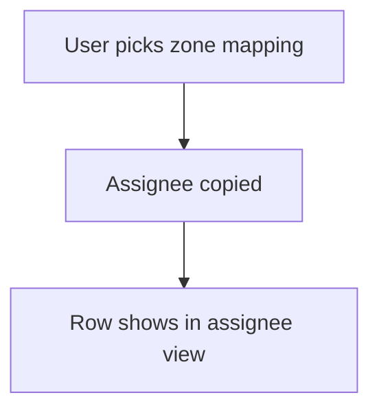

# Auto assign by mapping sheet

## Task

A lead or project goes to the executive (and manager) of its zone.

## How

- Mapping sheet of executive, zone and manager.
- Ref to the mapping row; assignee and manager pickUser copied from the ref.

## Workaround

No. Direct feature (ref with copied pickUser).

## Limits

- One executive per zone row; sharing needs more rows.

## Flowchart

