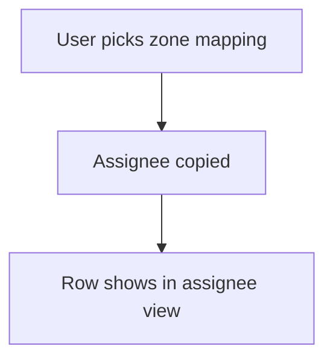

# Auto assign by mapping sheet

## Task

A lead or project goes to the executive (and manager) of its zone.

## How

- Mapping sheet of executive, zone and manager.
- Ref to the mapping row; assignee and manager pickUser copied from the ref.

## Workaround

No. Direct feature (ref with copied pickUser).

## Limits

- One executive per zone row; sharing needs more rows.

## Flowchart

## Execute

Only use this to apply this into a Studio Enterprise via MCP.

Placeholders: `ZoneMap` form, `ZoneMapSheet`, picking form `Lead`, roles `Admin` / `Executive` / `Manager`. Needs first: roles.

1. Form: `add kind=form name=ZoneMap` → `kind=composite type=section` → `type=text name=Zone`, `type=pickUser name=Executive roleIdDataSource=["Executive"]`, `type=pickUser name=Manager roleIdDataSource=["Manager"]`.
2. Sheet: `add kind=spreadsheet name=ZoneMapSheet form=ZoneMap insertRoles=["Admin"] updateRoles=["Admin"] queryables=["Zone"]` → `kind=spreadsheetLayout kind=table name=ZoneMapTable showComps=[...]` → `kind=spreadsheetLayout kind=list name=ZoneMapPickList`.
3. Keeper: `add kind=action kind=spreadsheetEditor name=ZoneMapEditor spreadsheet=ZoneMapSheet layoutSpreadsheet=ZoneMapTable` → `set kind=group actionPermissionMap` `{"ZoneMapEditor":{"roles":["Admin"]}}`.
4. On `Lead`: `type=pickUser name=Assignee disabled=true roleIdDataSource=["Executive"]`, `type=pickUser name=AssigneeManager disabled=true roleIdDataSource=["Manager"]` → `type=ref name=Zone spreadsheet=ZoneMapSheet layoutSpreadsheet=ZoneMapPickList copyFieldMap=<Executive → Assignee, Manager → AssigneeManager>` (verify: describe).
5. Assignee view: `var kind=condition` (Assignee equalTo caller) → `action kind=spreadsheetEditor filterCondition={cond:<var>,negation:false}` for Executive (verify: describe).
6. `validate` till ok=true.

Gaps: `copyFieldMap` shape and caller binder in the condition unconfirmed.
