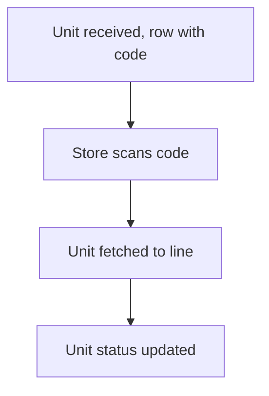

# Bar code per stock unit

## Task

Each received unit (coil, tool) has its own code and status; store scans or types it to issue.

## How

- One row per unit with showCode field and a status pickText.
- scanCode field plus a typed code field and a fetch button on the issue form.
- Workflow clears the field not used.

## Workaround

No. Direct feature (code fields). The scan-or-type clearing is a small stand-in for an either-or field.

## Limits

- Unit rows grow fast; status must be kept up by workflows.

## Flowchart

## Execute

Only use this to apply this into a Studio Enterprise via MCP.

Placeholders: `Unit` form, `UnitSheet`, `VarUnitStatus`, `Issue` form, `IssueSheet`, `UnitIssueWf`. Needs first: none.

1. Var: `add kind=var kind=setOfText name=VarUnitStatus deploy=fixedOnDeploy value={"In Stock":{},"Issued":{}}`.
2. Unit form: section → `type=text name=UnitCode` → `type=showCode name=UnitLabel codeType=barCode default=<pattern from UnitCode>` → `type=pickText name=Status source=VarUnitStatus`.
3. Sheet: `add kind=spreadsheet name=UnitSheet form=Unit queryables=["UnitCode","Status"] uniqueIndexs=["UnitCode"]`.
4. Issue form: `type=scanCode name=ScanCode barCode=true`, `type=text name=TypedCode`, `type=button name=Fetch buttonKind=normal targetType=callReport report=<unit by code report> reportInputMapping=... reportOutputMapping=...` (verify: describe). Sheet `IssueSheet`.
5. Workflow: `add kind=workflow name=UnitIssueWf` (4 maps `{}`) → `kind=eventSsInsertBefore spreadsheet=IssueSheet` → `kind=branchIfElse option=Condition condition=<ScanCode hasValue>` → TRUE `kind=fieldRemove field={param:"$Curr",field:"TypedCode"}`, FALSE `fieldRemove` ScanCode.
6. Status: `kind=eventSsInsertAfter spreadsheet=IssueSheet` → `kind=rowUpdate rowIdPointer={spreadsheet:"UnitSheet",row:<unit row id>} option=Mapping outputMapping=<Status = keyIssued>`.
7. Edges: NEXT chain; branchIfElse TRUE / FALSE. `validate` till ok=true.

Gaps: fetch report wiring, field edits in insert-before saving, unit row id binder unconfirmed.
