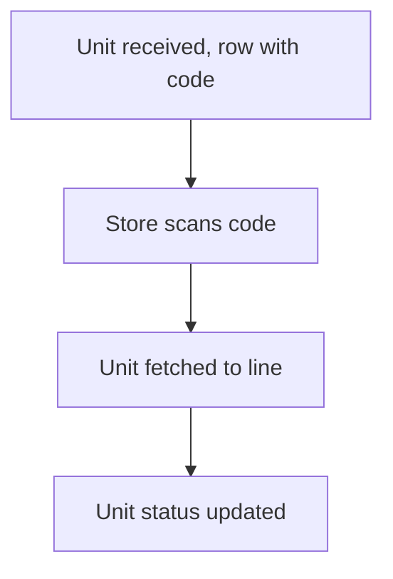

# Bar code per stock unit

## Task

Each received unit (coil, tool) has its own code and status; store scans or types it to issue.

## How

- One row per unit with showCode field and a status pickText.
- scanCode field plus a typed code field and a fetch button on the issue form.
- Workflow clears the field not used.

## Workaround

No. Direct feature (code fields). The scan-or-type clearing is a small stand-in for an either-or field.

## Limits

- Unit rows grow fast; status must be kept up by workflows.

## Flowchart

