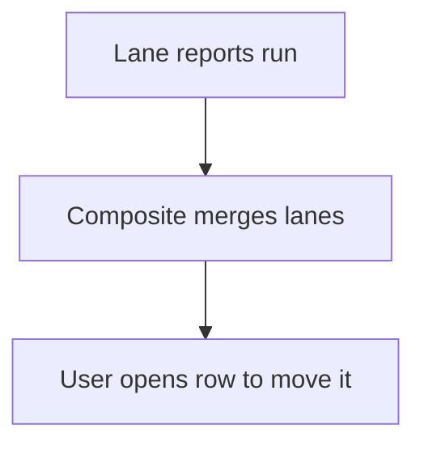

# Board from lane reports

## Task

See items in lanes side by side (backlog, next sprint, current sprint).

## How

- One spreadsheet report per lane.
- Composite report merges the lanes into one screen.

## Workaround

Yes. No board view; lane reports stand in.

## Limits

- No drag between lanes; status is changed on the row.

## Flowchart

