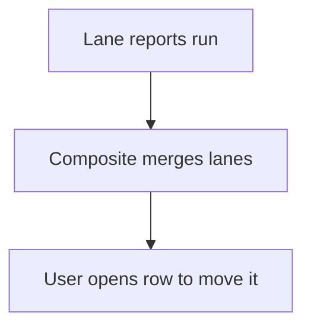

# Board from lane reports

## Task

See items in lanes side by side (backlog, next sprint, current sprint).

## How

- One spreadsheet report per lane.
- Composite report merges the lanes into one screen.

## Workaround

Yes. No board view; lane reports stand in.

## Limits

- No drag between lanes; status is changed on the row.

## Flowchart

## Execute

Only use this to apply this into a Studio Enterprise via MCP.

Placeholders: `Item` form, `ItemSheet` with pickText `Lane`, lanes Backlog / Next / Current, `Board` action. Needs first: the sheet.

1. Lane filter: per lane `add kind=var kind=condition name=InBacklog value={node:<Lane equalTo keyBacklog>,sourceForm:"Item"}` (verify: describe).
2. Lane output form: `add kind=form name=BacklogOut` → `kind=composite type=grid name=Items` → fields → `kind=gridLayout kind=table name=BacklogTable showComps=[...]` → `kind=formLayout type=content name=BacklogView direction=vertical rootLayout=true flexCenter={gridLayouts:["BacklogTable"]}`.
3. Mapping: `add kind=var kind=mapping name=BacklogMap value={fromForm:"Item",toForm:"BacklogOut",toGrid:"Items",fieldMappingMap:{Title:{from:{kind:"field",value:{field:"Title"}},to:"Title"}}}`.
4. Lane report: `add kind=report kind=spreadsheet name=BacklogReport outputForm=BacklogOut fromSpreadsheet=ItemSheet outputFormMapping=BacklogMap filterCondition={cond:"InBacklog",negation:false}`. Repeat 1-4 per lane.
5. Board: apply PAT-composite-report Execute with `mergeReports=["BacklogReport","NextReport","CurrentReport"]`; root layout `direction=horizontal` for side by side.
6. Action: `add kind=action kind=report name=Board report=BoardReport outputFormContentLayout=<root layout>` → `set kind=group actionPermissionMap`.
7. `validate` till ok=true.

Gaps: composite report output form / layout shape unconfirmed; no drag between lanes.
