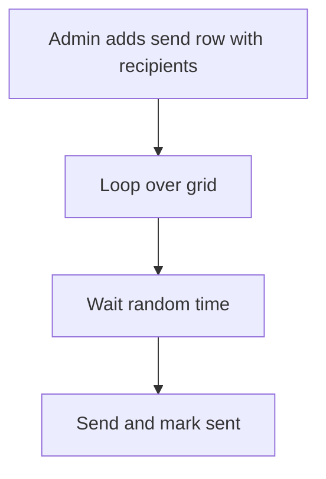

# Bulk message loop with delay

## Task

Send one message to every customer or lead in a list, one by one.

## How

- Send sheet with a grid of recipients copied from customers or leads.
- Workflow on insert-after iterates the grid with a wait node.
- Random delay per row from a formula (delay number plus duration field).
- sendWhatsappMessage or email per row; row update marks it sent.

## Workaround

Yes. No bulk send or throttle step; a grid loop with a random wait stands in.

## Limits

- Long lists run long; one send row per batch helps.
- Message rules of the channel still apply.

## Flowchart

