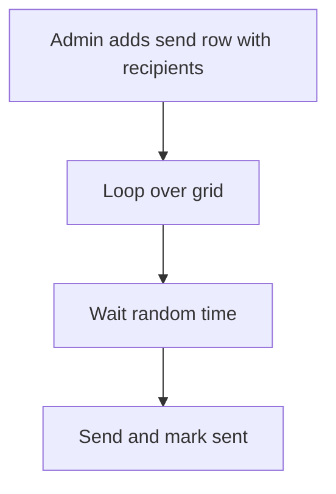

# Bulk message loop with delay

## Task

Send one message to every customer or lead in a list, one by one.

## How

- Send sheet with a grid of recipients copied from customers or leads.
- Workflow on insert-after iterates the grid with a wait node.
- Random delay per row from a formula (delay number plus duration field).
- sendWhatsappMessage or email per row; row update marks it sent.

## Workaround

Yes. No bulk send or throttle step; a grid loop with a random wait stands in.

## Limits

- Long lists run long; one send row per batch helps.
- Message rules of the channel still apply.

## Flowchart

## Execute

Only use this to apply this into a Studio Enterprise via MCP.

Placeholders: `Send` form, `SendSheet`, grid `Recipients`, `BulkSendWf`. Needs first: customer or lead sheet to copy from.

1. Form: `add kind=form name=Send` → `kind=composite type=section` (`type=paragraph name=Message`) → `kind=composite type=grid name=Recipients` → `type=text name=Name`, `type=mobileNumber name=Mobile`, `type=number name=Delay`, `type=bool name=Sent`.
2. Sheet: `add kind=spreadsheet name=SendSheet form=Send insertRoles=["Admin"]`. Fill grid from customers by mapping or a `callReport` button (verify: describe).
3. Workflow: `add kind=workflow name=BulkSendWf` (4 maps `{}`) → `kind=eventSsInsertAfter spreadsheet=SendSheet` → `kind=branchIterateGrid grid=Recipients`.
4. Loop body: `kind=applyFormula assignToField={param:"$Iter",field:"Delay"} javascriptFormula={value:"30 + Math.floor(Math.random()*60)"}` → `kind=wait duration=<binder from $Iter Delay, seconds>` → `kind=sendWhatsappMessage toUsers=<$Iter Mobile> message={value:"${Message}",paramSet:["Message"]}` (or `sendEmail`) → `kind=fieldSet value=<constant true> outputField={param:"$Iter",field:"Sent"}`.
5. After loop: `kind=rowUpdate rowIdPointer={spreadsheet:"SendSheet",row:<$Curr row id>} option=Mapping` to save Sent flags.
6. Edges: event → iterate NEXT; iterate → applyFormula ITERATE; body NEXT chain; last body node → iterate NEXT; iterate → rowUpdate NEXT.
7. `validate` till ok=true.

Gaps: `wait` duration binder from a field, `toUsers` from a mobile field, saving `$Iter` edits back unconfirmed.
