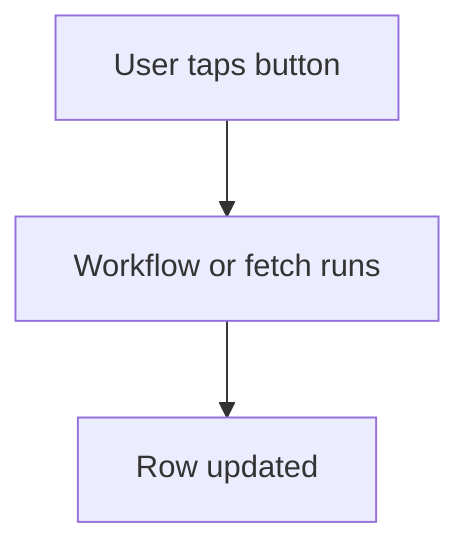

# Button runs a workflow

## Task

User taps a button to fetch details, get a balance or mark a row done.

## How

- button field on the form.
- eventManualTrigger workflow or a report fetch tied to the button.
- Row update with the result.

## Workaround

No. Direct feature (button and manual trigger).

## Limits

- User must remember to tap it.

## Flowchart

