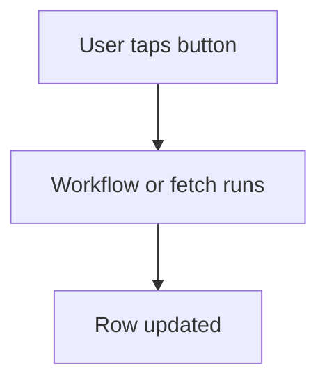

# Button runs a workflow

## Task

User taps a button to fetch details, get a balance or mark a row done.

## How

- button field on the form.
- eventManualTrigger workflow or a report fetch tied to the button.
- Row update with the result.

## Workaround

No. Direct feature (button and manual trigger).

## Limits

- User must remember to tap it.

## Flowchart

## Execute

Only use this to apply this into a Studio Enterprise via MCP.

Placeholders: `Thing` form, `ThingSheet`, `FetchWf`. Needs first: the sheet.

1. Workflow: `add kind=workflow name=FetchWf` (4 maps `{}`) → `kind=eventManualTrigger inputForm={form:"Thing"}` → work node (`executeReport report=...`, `rowGet`, `executeRpc`) → `kind=rowUpdate rowIdPointer={spreadsheet:"ThingSheet",row:<row id binder>} option=Mapping outputMapping=<result → Thing>`.
2. Edges: `set kind=workflow edgeMap` NEXT chain; ERROR from work node → `sendMessageToUsers`.
3. Button: `add kind=field parent=Thing type=button name=Fetch buttonKind=normal workflowPointer={autoDia:<FetchWf>,startNode:<event node>}` (verify: describe).
4. Fetch-only variant: `type=button targetType=callReport report=<report> reportInputMapping=... reportOutputMapping=...`.
5. `validate` till ok=true.

Gaps: `workflowPointer` shape, how the manual trigger gets the row id unconfirmed.
