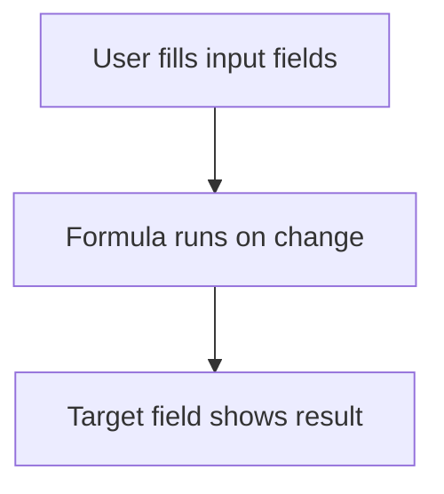

# Calculated field by formula

## Task

Work out a value on the form from other fields (refund, hours, day status, salary parts, leave days, days taken, weekday).

## How

- Formula logic on the target field.
- onInitAndOnChange event so it updates as the user types.
- JavaScript expressions for dates, rounding and lookup maps.

## Workaround

No. Direct feature (formula logic).

## Limits

- Long formulas are hard to check; keep them short or split them.
- Values only change when the form runs; rows changed by workflows keep the old value.

## Flowchart

