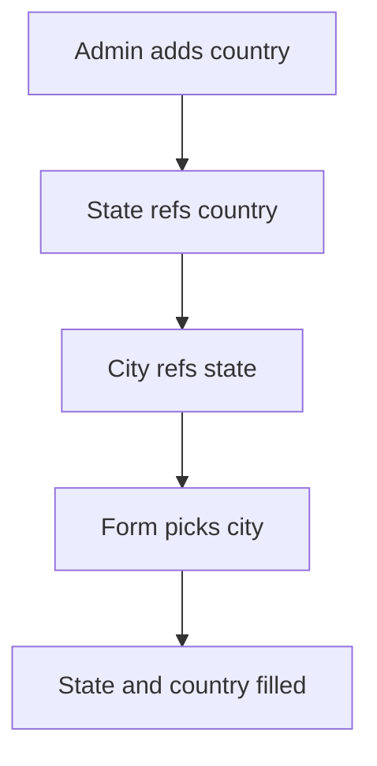

# Chained place lists

## Task

Country, state, city (or zone, state, town, area) lists link up; picking the lowest level fills the levels above.

## How

- One sheet per level; each refs its parent and copies the parent text and rowId.
- Lower levels copy all levels above through the ref chain.
- A zone can hold a grid of cities.
- Lighter form: city sheet with state as pickText.

## Workaround

No. Direct feature (chained refs with copied fields).

## Limits

- Renaming a place does not update rows that copied it earlier.

## Flowchart

