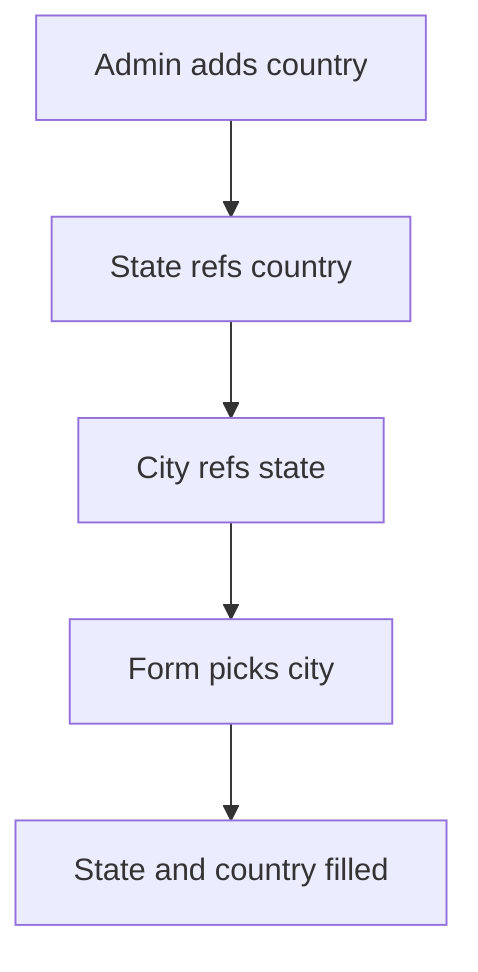

# Chained place lists

## Task

Country, state, city (or zone, state, town, area) lists link up; picking the lowest level fills the levels above.

## How

- One sheet per level; each refs its parent and copies the parent text and rowId.
- Lower levels copy all levels above through the ref chain.
- A zone can hold a grid of cities.
- Lighter form: city sheet with state as pickText.

## Workaround

No. Direct feature (chained refs with copied fields).

## Limits

- Renaming a place does not update rows that copied it earlier.

## Flowchart

## Execute

Only use this to apply this into a Studio Enterprise via MCP.

Placeholders: forms `Country` / `State` / `City`, sheets `CountrySheet` / `StateSheet` / `CitySheet`, picking form `Thing`. Needs first: PAT-admin-kept-pick-list Execute for the top level (`Country`, `CountrySheet`, list layout `CountryPickList`).

1. State form: `add kind=form name=State` → section → `type=text name=StateName`, `type=text name=CountryName disabled=true` → `type=ref name=Country spreadsheet=CountrySheet layoutSpreadsheet=CountryPickList copyFieldMap=<CountryName>` (verify: describe).
2. State sheet: `add kind=spreadsheet name=StateSheet form=State insertRoles=["Admin"] updateRoles=["Admin"] queryables=["StateName"]` → `spreadsheetLayout kind=table` + `kind=list name=StatePickList`.
3. City: same shape; `ref name=State spreadsheet=StateSheet layoutSpreadsheet=StatePickList copyFieldMap=<StateName, CountryName>` (copies both levels).
4. On `Thing`: text fields `CityName`, `StateName`, `CountryName` (`disabled=true`) → `type=ref name=City spreadsheet=CitySheet layoutSpreadsheet=CityPickList copyFieldMap=<all three>`.
5. Zone with cities: zone form `type=refSet name=Cities spreadsheet=CitySheet displayField=CityName`.
6. Light form: city sheet with `type=pickText name=State source=<setOfText var>` instead of a state sheet.
7. Keeper actions + group map: as in PAT-admin-kept-pick-list. `validate` till ok=true.

Gaps: `copyFieldMap` shape unconfirmed.
