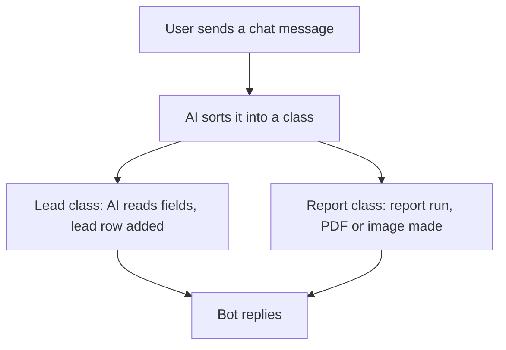

# Chat bot by message class

## Task

A chat message to the app is sorted by AI into a kind; each kind runs its own steps (make a lead, or send a dashboard back as a PDF or image).

## How

- Workflow on eventChat.
- aiTextToClassification sorts the message into a class.
- Branch on the class.
- Lead class: aiTextToForm reads the fields, then rowInsert into the lead sheet.
- Report class: executeReport on a dashboard, generatePdf or generateImage, then bot response node sends it back.

## Workaround

No. Direct feature (chat event, AI and bot response nodes).

## Limits

- AI class can be wrong; keep a fallback reply for unknown messages.
- Read fields need a human check before they drive other steps.

## Flowchart

