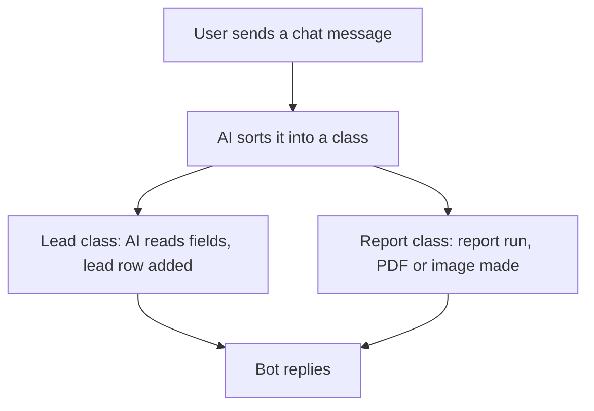

# Chat bot by message class

## Task

A chat message to the app is sorted by AI into a kind; each kind runs its own steps (make a lead, or send a dashboard back as a PDF or image).

## How

- Workflow on eventChat.
- aiTextToClassification sorts the message into a class.
- Branch on the class.
- Lead class: aiTextToForm reads the fields, then rowInsert into the lead sheet.
- Report class: executeReport on a dashboard, generatePdf or generateImage, then bot response node sends it back.

## Workaround

No. Direct feature (chat event, AI and bot response nodes).

## Limits

- AI class can be wrong; keep a fallback reply for unknown messages.
- Read fields need a human check before they drive other steps.

## Flowchart

## Execute

Only use this to apply this into a Studio Enterprise via MCP.

Placeholders: `VarMessageClass` (Lead, Report, Other), `LeadRead` form, `LeadSheet`, dashboard report `DashReport`, `ChatBotWf`. Needs first: lead sheet, dashboard report with a content layout, AI keychain.

1. Var: `add kind=var kind=setOfText name=VarMessageClass deploy=fixedOnDeploy value={"Lead":{},"Report":{},"Other":{}}`.
2. Workflow: `add kind=workflow name=ChatBotWf` (4 maps `{}`) → `kind=eventChat` → `kind=botHistoryAddPrompt promptField=<message field>` → `kind=aiTextToClassification inputField=<message field> classification=VarMessageClass keychain=<name> aiProvider=openAI_5_4_MINI`.
3. Lead: `kind=aiTextToForm inputField=<message field> outputForm=LeadRead` → `paramUpdate option=Mapping` → `rowInsert spreadsheet=LeadSheet` (insert-row pattern in guide) → `botBuildResponse contentField=<constant "Lead added">` → `botSendResponse`.
4. Report: `kind=executeReport report=DashReport outputParamName=Dash` → `kind=generatePdf contentLayout=<dash layout> outputField=<doc field>` (or `generateImage`) → `kind=botBuildResponse attachmentField=<doc field>` → `kind=botSendResponse`.
5. Other / Default: `botBuildResponse` fallback text → `botSendResponse`.
6. Edges: NEXT chain; classification → lead VALUE `keyLead`, → report VALUE `keyReport`, NEXT = fallback; ai nodes ERROR → fallback.
7. `validate` till ok=true.

Gaps: chat message field ref, `outputField` param for PDF, bot binder shapes unconfirmed (verify: describe).
