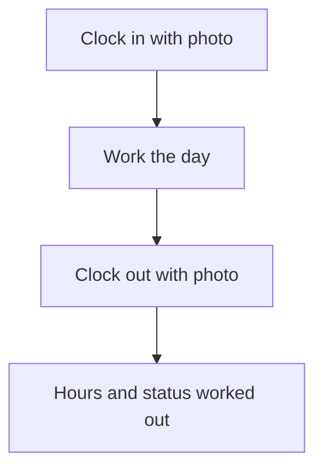

# Clock in and out with photo and place

## Task

Staff mark start and end of day with a photo, time, place and optional km reading.

## How

- Bool clock in and clock out fields that capture time.
- Camera fields for the photos; geo point; start and end km numbers.
- Insert-before and update-before workflows or formulas fill time, address, hours, late or on time, day status.

## Workaround

No. Direct feature (capture fields, formulas, before events).

## Limits

- Missed clock out needs a day-end job or a regularisation request.

## Flowchart

## Execute

Only use this to apply this into a Studio Enterprise via MCP.

Placeholders: `Attendance` form, `AttendanceSheet`, `Staff` role, `AttendanceCalcWf`. Needs first: role.

1. Form: `add kind=form name=Attendance` → section → `type=bool name=ClockIn captureTime=true captureLocation=true captureUser=true`, `type=camera name=InPhoto`, `type=number name=StartKm`; same for `ClockOut`, `OutPhoto`, `EndKm`; `type=geoPoint name=Place`.
2. Outputs: `type=decimal name=Hours disabled=true`, `type=pickText name=DayStatus source=<setOfText var> disabled=true`, `type=text name=Address disabled=true`.
3. Sheet: `add kind=spreadsheet name=AttendanceSheet form=Attendance insertRoles=["Staff"] updateRoles=["Staff"] partitionMap={Day:{assignPartitionField:<text day key>,formula:...}}` (one row per staff per day; verify: describe).
4. Formulas: `add kind=formFormula assignToField=Hours formula={value:"..."}`; same for DayStatus (late or on time).
5. Or workflow: `add kind=workflow name=AttendanceCalcWf` → `kind=eventSsInsertBefore spreadsheet=AttendanceSheet` and `kind=eventSsUpdateBefore` → `kind=applyFormula assignToField={param:"$Curr",field:"Hours"} javascriptFormula={value:"..."}`; edges NEXT.
6. Action: `add kind=action kind=rowInsert spreadsheet=AttendanceSheet chatBubbleHeader={title,subTitle}` (needed with partitionMap) → `set kind=group actionPermissionMap` Staff.
7. `validate` till ok=true.

Gaps: captured time / place value paths in formulas, `partitionMap.formula` shape unconfirmed; missed clock out needs a day-end job (not built here).
