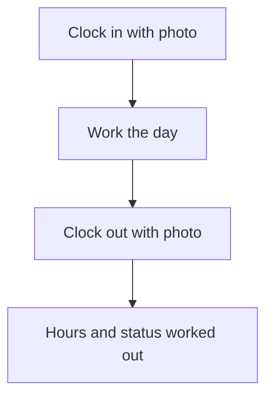

# Clock in and out with photo and place

## Task

Staff mark start and end of day with a photo, time, place and optional km reading.

## How

- Bool clock in and clock out fields that capture time.
- Camera fields for the photos; geo point; start and end km numbers.
- Insert-before and update-before workflows or formulas fill time, address, hours, late or on time, day status.

## Workaround

No. Direct feature (capture fields, formulas, before events).

## Limits

- Missed clock out needs a day-end job or a regularisation request.

## Flowchart

