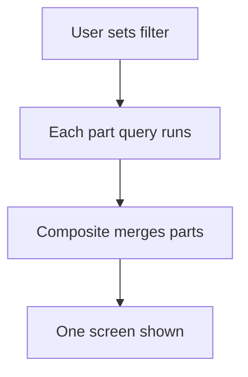

# Composite report from merged parts

## Task

Show one screen (dashboard, profile, summary, print) built from several report parts.

## How

- One query report per part: a section of totals, grids of details, charts.
- Composite report merges the parts into one output form.
- One filter form (date range, month, team, user) feeds all parts.
- Report action per role.

## Workaround

No. Direct feature (composite report).

## Limits

- Each part is its own query; many parts slow the screen.
- Role scoping needs a copy per role (see PAT-role-copy-of-report).

## Flowchart

