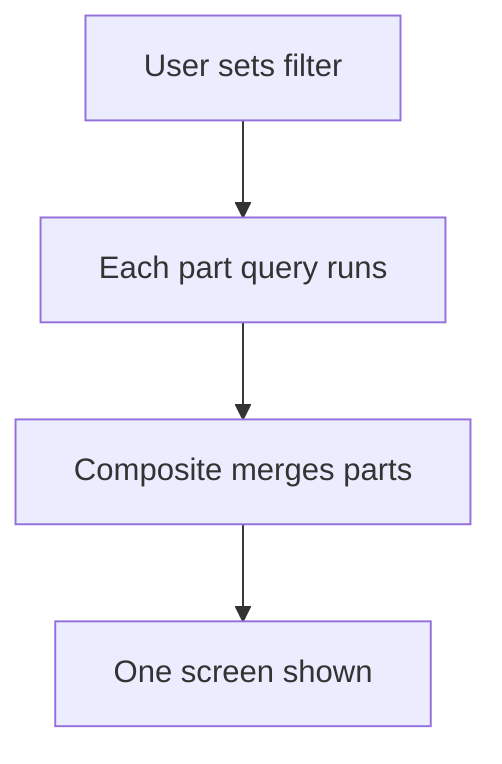

# Composite report from merged parts

## Task

Show one screen (dashboard, profile, summary, print) built from several report parts.

## How

- One query report per part: a section of totals, grids of details, charts.
- Composite report merges the parts into one output form.
- One filter form (date range, month, team, user) feeds all parts.
- Report action per role.

## Workaround

No. Direct feature (composite report).

## Limits

- Each part is its own query; many parts slow the screen.
- Role scoping needs a copy per role (see PAT-role-copy-of-report).

## Flowchart

## Execute

Only use this to apply this into a Studio Enterprise via MCP.

Placeholders: filter form `DashFilter`, part reports `TotalsPart` / `DetailsPart`, `DashOut` form, `DashReport`, role `Manager`. Needs first: source sheets.

1. Filter form: `add kind=form name=DashFilter` → section → `type=dateRange name=Period`, `type=pickUser name=User roleIdDataSource=[...]`.
2. Part output forms: per part `add kind=form` → `kind=composite type=section` (totals) or `type=grid` (details) → fields → `kind=gridLayout kind=table showComps=[...]` or chart kind (`xyChartBarGraph xAxis=...`).
3. Part reports: `add kind=report kind=query name=TotalsPart inputForm=DashFilter outputForm=TotalsOut neoQL={value:"..."} fromSpreadsheets=[...]`. Repeat per part.
4. Merged form: `add kind=form name=DashOut` with the parts' composites → `kind=formLayout type=content name=DashView direction=vertical rootLayout=true flexCenter={gridLayouts:[...]}`.
5. Composite: `add kind=report kind=composite name=DashReport inputForm=DashFilter outputForm=DashOut mergeReports=["TotalsPart","DetailsPart"]`.
6. Action: `add kind=action kind=report name=Dashboard report=DashReport outputFormContentLayout=DashView` → `set kind=group actionPermissionMap` `{"Dashboard":{"roles":["Manager"]}}`.
7. `validate` till ok=true.

Gaps: how parts' outputs map into the merged form (same composite names?) unconfirmed (verify: describe).
