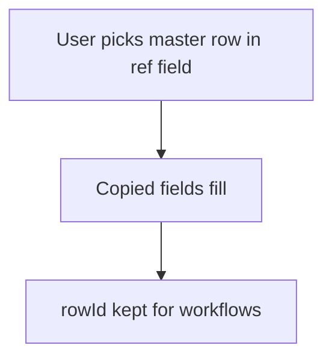

# Copy fields from a picked row

## Task

Pick a master or parent row once and show its details (contact, price, plan, balance) on the new row.

## How

- ref field to the master or parent sheet.
- Fields copied from the ref (text, number, pickText, logNumber) plus a rowId field for later workflow updates.
- Sometimes a button to fetch details again.

## Workaround

No. Direct feature (ref with copied fields).

## Limits

- Copied values are taken at pick time; later master changes do not flow down.
- Copied logNumber shows the balance at pick time only.

## Flowchart

## Execute

Only use this to apply this into a Studio Enterprise via MCP.

Placeholders: master `Customer` / `CustomerSheet` (list layout `CustomerPickList`), picking form `Order`. Needs first: master sheet with a list or card layout.

1. Copy targets on `Order`: `type=text name=ContactName disabled=true`, `type=decimal name=Price disabled=true`, `type=pickText name=Plan source=<same var as master>`, `type=logNumber name=Balance`, `type=text name=CustomerRowId disabled=true`.
2. Ref: `add kind=field parent=Order type=ref name=Customer spreadsheet=CustomerSheet layoutSpreadsheet=CustomerPickList keyFields=[...] copyFieldMap=<master field → target field, rowId → CustomerRowId>` (verify: describe).
3. Fetch again: `refreshOn=refreshOnDemand` on the ref, or a `type=button` (see PAT-button-runs-workflow).
4. `validate` till ok=true.

Gaps: `copyFieldMap` shape and how rowId is copied unconfirmed; copied values do not follow later master changes.
