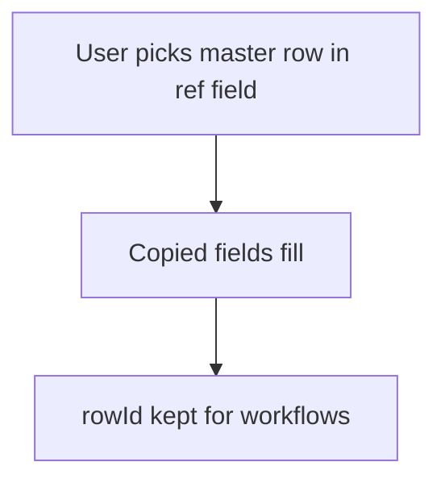

# Copy fields from a picked row

## Task

Pick a master or parent row once and show its details (contact, price, plan, balance) on the new row.

## How

- ref field to the master or parent sheet.
- Fields copied from the ref (text, number, pickText, logNumber) plus a rowId field for later workflow updates.
- Sometimes a button to fetch details again.

## Workaround

No. Direct feature (ref with copied fields).

## Limits

- Copied values are taken at pick time; later master changes do not flow down.
- Copied logNumber shows the balance at pick time only.

## Flowchart

