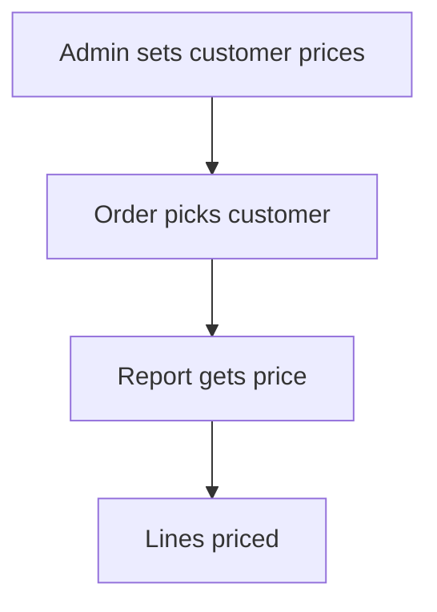

# Customer price or discount list

## Task

Keep a price or discount per customer for each product or category, and use it on orders.

## How

- Grid on the customer row: product or category ref plus price or discount.
- Query report returns the price or discount for the order form.
- Before-insert workflow or report ref applies it to each line.

## Workaround

No. Direct feature (grid plus report).

## Limits

- No validity dates unless added.

## Flowchart

## Execute

Only use this to apply this into a Studio Enterprise via MCP.

Placeholders: `Customer` / `CustomerSheet`, `ProductSheet` (list layout `ProductPickList`), `Order` / `OrderSheet` with grid `Lines`, `PriceFor` report, `OrderPriceWf`. Needs first: customer, product and order sheets.

1. Price grid on `Customer`: `add kind=composite parent=Customer type=grid name=Prices fieldMap={}` → `type=ref name=Product spreadsheet=ProductSheet layoutSpreadsheet=ProductPickList` → `type=decimal name=Price`, `type=decimal name=Discount`.
2. Price report: input form (`Customer`, `Product` text keys) + output form section (`Price`, `Discount`) → `add kind=report kind=query name=PriceFor inputForm=... outputForm=... neoQL={value:"..."} fromSpreadsheets=["CustomerSheet"]`.
3. Apply per line, option A: workflow `add kind=workflow name=OrderPriceWf` (4 maps `{}`) → `kind=eventSsInsertBefore spreadsheet=OrderSheet` → `kind=branchIterateGrid grid=Lines` → ITERATE `kind=executeReport report=PriceFor outputParamName=P` → `kind=fieldSet value=
 outputField={param:"$Iter",field:"Price"}`; last → NEXT back to iterate.
4. Option B: line field `type=refReport name=PriceRef report=PriceFor grid=<output grid> layoutGrid=<gridLayout> copyFieldMap=<Price>` (verify: describe).
5. `validate` till ok=true.

Gaps: report input binding from `$Iter` in executeReport, `refReport` copy shape unconfirmed; no validity dates.
