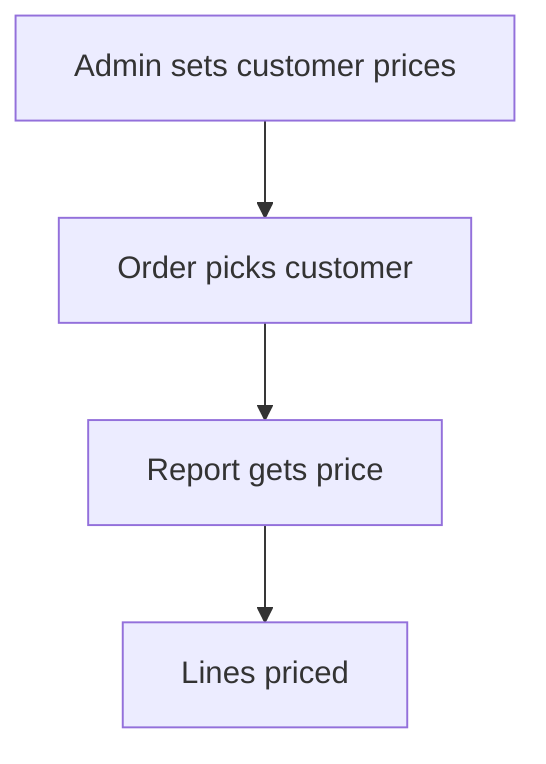

# Customer price or discount list

## Task

Keep a price or discount per customer for each product or category, and use it on orders.

## How

- Grid on the customer row: product or category ref plus price or discount.
- Query report returns the price or discount for the order form.
- Before-insert workflow or report ref applies it to each line.

## Workaround

No. Direct feature (grid plus report).

## Limits

- No validity dates unless added.

## Flowchart

