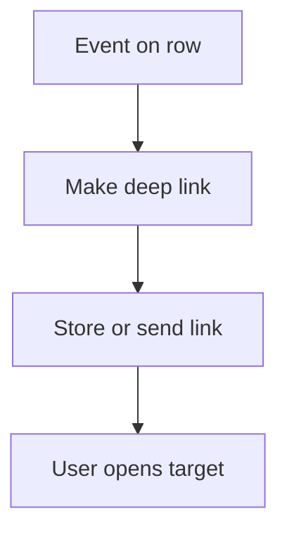

# Deep link opens a form or row

## Task

Send the user straight to a form or row (new lead or order from a visit, request link by email, payslip link).

## How

- generateDeeplink node to an action or row.
- Row update stores the link; message or email sends it.

## Workaround

No. Direct feature (deeplink).

## Limits

- Link opens only for users with rights to the target.

## Flowchart

## Execute

Only use this to apply this into a Studio Enterprise via MCP.

Placeholders: target `LeadSheet`, source `VisitSheet` with `type=hyperlink name=LeadLink`, `OpenLeadLink`, `VisitLinkWf`. Needs first: both sheets; roles that may open the target.

1. Deeplink: `add kind=deeplink kind=spreadsheetInsert name=OpenLeadLink spreadsheet=LeadSheet visibilityConstraint=enforceEnterpriseUserSignIn creationRoles=["Staff"] expiry=withinOneWeek successMessage={arg:<text var>}`. Row variant: `kind=spreadsheetRow spreadsheet=... formContentLayout=...`; report variant: `kind=report report=... outputFormContentLayout=...`.
2. Workflow: `add kind=workflow name=VisitLinkWf` (4 maps `{}`) → `kind=eventSsInsertAfter spreadsheet=VisitSheet` → `kind=generateDeeplink deeplink=OpenLeadLink outputField={param:"$Curr",field:"LeadLink"}`.
3. Then `kind=rowUpdate rowIdPointer={spreadsheet:"VisitSheet",row:<$Curr row id>} option=Mapping` (store link) → `kind=sendEmail subject={value:"..."} message={value:"${LeadLink}",paramSet:["LeadLink"]} toUsers=...` or `sendMessageToUsers`.
4. Edges: NEXT chain; generateDeeplink ERROR → `sendMessageToUsers` to admin.
5. `validate` till ok=true.

Gaps: prefill of target fields from the source row (`userFieldMap` / `spreadsheetEditorAction`) unconfirmed (verify: describe).
