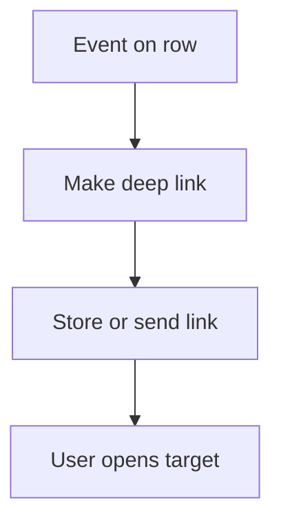

# Deep link opens a form or row

## Task

Send the user straight to a form or row (new lead or order from a visit, request link by email, payslip link).

## How

- generateDeeplink node to an action or row.
- Row update stores the link; message or email sends it.

## Workaround

No. Direct feature (deeplink).

## Limits

- Link opens only for users with rights to the target.

## Flowchart

