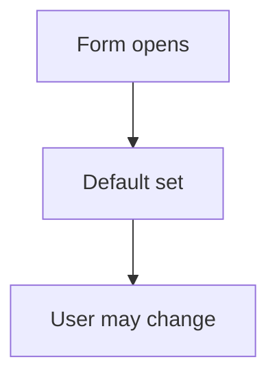

# Default value on a form

## Task

Fields start with a sensible value (current month and year, Pending status).

## How

- Formula on the field with onInitAndOnChange.
- Or insert-before workflow with fieldSet.

## Workaround

No. Direct feature (formula or fieldSet).

## Limits

- Formula defaults can overwrite a user change if not guarded.

## Flowchart

