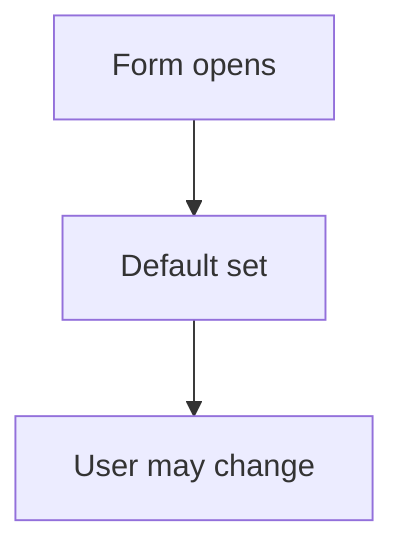

# Default value on a form

## Task

Fields start with a sensible value (current month and year, Pending status).

## How

- Formula on the field with onInitAndOnChange.
- Or insert-before workflow with fieldSet.

## Workaround

No. Direct feature (formula or fieldSet).

## Limits

- Formula defaults can overwrite a user change if not guarded.

## Flowchart

## Execute

Only use this to apply this into a Studio Enterprise via MCP.

Placeholders: form `Thing`, `ThingSheet`, fields `ForMonth`, `Status`. Needs first: the form.

1. Fixed default, no logic: field props, e.g. `type=month defaultValue=CurrentMonth`, `type=date defaultValue={value:"startOfMonth"}`, `type=pickText defaultOption=keyPending`.
2. Formula default, guarded: `add kind=formEventCondition name=MonthEmpty statement={lhs:"ForMonth",operator:"hasNoValue"}` → `add kind=formEventAction kind=setValue name=SetMonth comps=["ForMonth"] source=<argBinder>` → `add kind=formEvent kind=onInitAndOnChange name=OnMonthDefault eventComps=["ForMonth"] actions=[{action:"SetMonth",condition:"MonthEmpty"}]`.
3. Workflow default: `add kind=workflow` (4 maps `{}`) → `kind=eventSsInsertBefore spreadsheet=ThingSheet` → `kind=fieldSet value=<constant binder> outputField={param:"$Curr",field:"Status"}`; edge NEXT.
4. `validate` till ok=true.

Gaps: `setValue` `source` binder value shape (run `schema kind=argBinder`).
