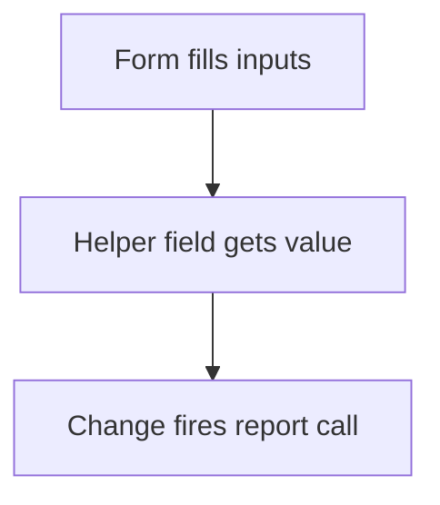

# Delayed report call by formula

## Task

Fetch data once the form has the values it needs (zone of the person, salary parts).

## How

- Helper text field with a formula that gets a value only when the inputs are filled.
- Its change fires the report call or the next formulas.

## Workaround

Yes. No on-load report call; a changing helper field triggers it.

## Limits

- Hard to see why it fires; name the helper field clearly.

## Flowchart

## Execute

Only use this to apply this into a Studio Enterprise via MCP.

Placeholders: form `Thing`, inputs `Person` / `Month`, helper `FetchKey`, report `ZoneFor`. Needs first: the report and its input / output mappings.

1. Helper: `add kind=field parent=Thing type=text name=FetchKey disabled=true`.
2. Formula: `add kind=formFormula name=FetchKeyCalc assignToField=FetchKey formula={value:"${f:Person} && ${f:Month} ? ${f:Person} + '-' + ${f:Month} : ''"}`.
3. Call: `type=button name=FetchZone buttonKind=normal targetType=callReport report=ZoneFor reportInputMapping=... reportOutputMapping=...`; hide it with `formEventAction kind=hidden comps=["FetchZone"]` on `onInitForm`.
4. Fire: `add kind=formEventCondition name=KeyReady statement={lhs:"FetchKey",operator:"hasValue"}` → `add kind=formEventAction kind=click name=ClickFetch comps=["FetchZone"]` → `add kind=formEvent kind=onChange name=OnFetchKey eventComps=["FetchKey"] actions=[{action:"ClickFetch",condition:"KeyReady"}]`.
5. `validate` till ok=true.

Gaps: `click` on a hidden button and formula changes firing `onChange` unconfirmed (verify: describe).
