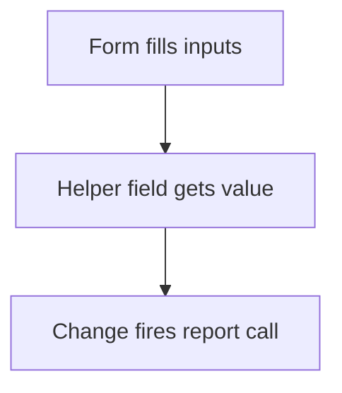

# Delayed report call by formula

## Task

Fetch data once the form has the values it needs (zone of the person, salary parts).

## How

- Helper text field with a formula that gets a value only when the inputs are filled.
- Its change fires the report call or the next formulas.

## Workaround

Yes. No on-load report call; a changing helper field triggers it.

## Limits

- Hard to see why it fires; name the helper field clearly.

## Flowchart

