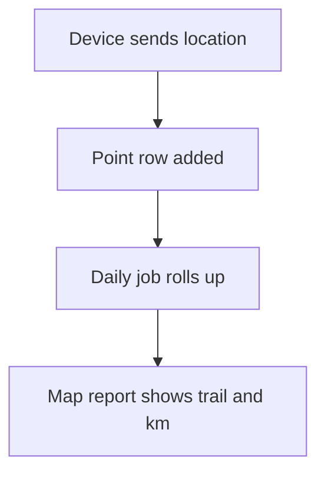

# Device location trail

## Task

Store where field staff are through the day and show it on a map with distance.

## How

- eventUserLocation workflow inserts a point row (user, geo point, time, source).
- Clock in, clock out and visits also insert points.
- Source pickText with a colour formula and pin shape for the map.
- Daily job rolls points into one row per person; distance from the point chain by formula.
- User online and offline events update the person row.

## Workaround

No. Direct feature (user location event, geo fields).

## Limits

- Point sheets grow fast; daily rollup and partitions help.
- Device settings decide how often points come.

## Flowchart

