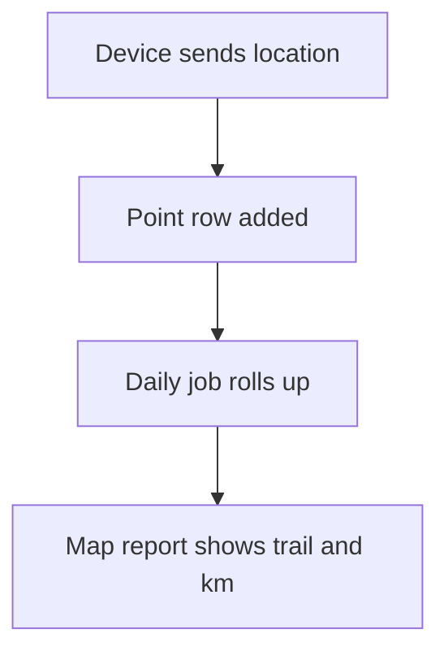

# Device location trail

## Task

Store where field staff are through the day and show it on a map with distance.

## How

- eventUserLocation workflow inserts a point row (user, geo point, time, source).
- Clock in, clock out and visits also insert points.
- Source pickText with a colour formula and pin shape for the map.
- Daily job rolls points into one row per person; distance from the point chain by formula.
- User online and offline events update the person row.

## Workaround

No. Direct feature (user location event, geo fields).

## Limits

- Point sheets grow fast; daily rollup and partitions help.
- Device settings decide how often points come.

## Flowchart

## Execute

Only use this to apply this into a Studio Enterprise via MCP.

Placeholders: `Point` form / `PointSheet`, `PersonDay` form / `PersonDaySheet`, `VarPointSource`, role `FieldStaff`, `PersonSheet`, `LocationTrailWf`. Needs first: role; `PersonSheet` with one row per FieldStaff user (Person `type=pickUser`).

1. Var: `add kind=var kind=setOfText name=VarPointSource deploy=fixedOnDeploy value={"Device":{},"Clock In":{},"Clock Out":{},"Visit":{}}`.
2. Point form: section → `type=pickUser name=Person roleIdDataSource=["FieldStaff"]`, `type=geoPoint name=Point`, `type=dateTime name=At`, `type=pickText name=Source source=VarPointSource`, `type=color name=PinColor`, `type=pinShape name=Pin`; `formFormula assignToField=PinColor` by Source.
3. Sheet: `add kind=spreadsheet name=PointSheet form=Point queryables=["Person","At"]` → `kind=spreadsheetLayout kind=map name=PointMap locationField=Point mapPin={shapeField:"Pin",colorField:"PinColor",labelField:"Person"}`.
4. Capture: `add kind=workflow name=LocationTrailWf` (4 maps `{}`) → `kind=eventUserLocation locationCapture={type:"scheduled",roles:["FieldStaff"],fromTime:"09:00:00",toTime:"19:00:00",frequencyBasedOnTime:...}` → `paramUpdate option=Mapping` → `rowInsert spreadsheet=PointSheet` (insert-row pattern in guide). Clock in / out and visit workflows add the same nodes.
5. Daily rollup: `kind=eventSchedule scheduler={repeatSetting:{frequency:1,repeatFrequencyKind:"days"}}` → `kind=branchIterateSpreadsheet spreadsheet=PersonSheet` (outer, one pass per person) → ITERATE `kind=branchIterateSpreadsheet spreadsheet=PointSheet filterCondition=<today and Person = outer Person> orderByFieldIds=[At]` → inner ITERATE `applyFormula` (distance) → inner NEXT `rowInsert spreadsheet=PersonDaySheet` (one row per person) → back to outer iterate.
6. Online / offline: `kind=eventUserOnline` / `kind=eventUserOffline` → `rowUpdate` on the person row.
7. Edges: NEXT chain; iterate ITERATE / NEXT. `validate` till ok=true.

Gaps: `locationCapture` frequency units, `scheduler` time zone, user binder in online events, distance formula across rows, nested iterate + inner filter on outer row's Person unconfirmed (verify: describe).
