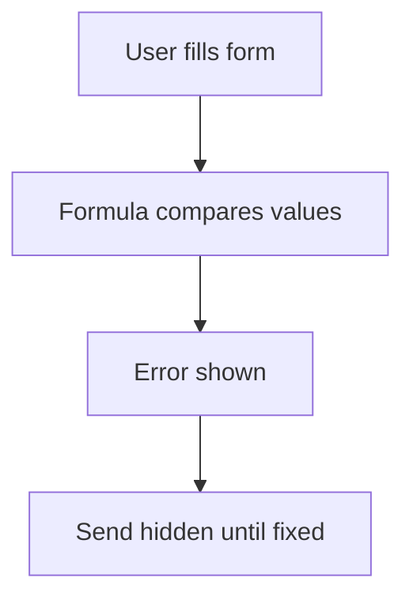

# Error field check on the form

## Task

Show an error on the form before save (balance short, material short, repeated numbers, bad quantity).

## How

- error field with a formula that compares values (often values pulled by a report ref).
- Visibility rule shows the error when it has a value.
- Error count field; send is hidden while the count has a value.

## Workaround

No. Direct feature (error field plus formula and visibility).

## Limits

- Checks only what the form can see; data written by workflows is not checked.

## Flowchart

