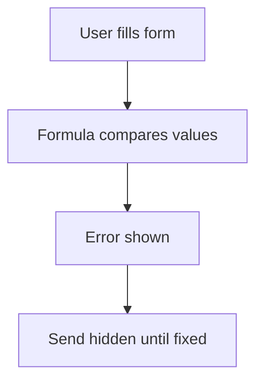

# Error field check on the form

## Task

Show an error on the form before save (balance short, material short, repeated numbers, bad quantity).

## How

- error field with a formula that compares values (often values pulled by a report ref).
- Visibility rule shows the error when it has a value.
- Error count field; send is hidden while the count has a value.

## Workaround

No. Direct feature (error field plus formula and visibility).

## Limits

- Checks only what the form can see; data written by workflows is not checked.

## Flowchart

## Execute

Only use this to apply this into a Studio Enterprise via MCP.

Placeholders: form `Issue`, fields `Qty` / `InStock`, error `StockError`, count `ErrorCount`. Needs first: the form; source of the compared value (ref or report ref).

1. Fields: `add kind=field parent=Issue type=error name=StockError`, `type=number name=ErrorCount disabled=true`.
2. Formulas: `add kind=formFormula name=StockErrorCalc assignToField=StockError formula={value:"${f:Qty} > ${f:InStock} ? 'Stock short' : ''"}`; `name=ErrorCountCalc assignToField=ErrorCount` (count non-empty error fields).
3. Show error: `add kind=formEventCondition name=HasStockError statement={lhs:"StockError",operator:"hasValue"}` → `formEventAction kind=hidden name=HideStockError comps=["StockError"]` + `kind=visible name=ShowStockError comps=["StockError"]`.
4. Hide send: `add kind=formEventCondition name=HasErrors statement={lhs:"ErrorCount",operator:"greaterThan",rhs:<constant 0>}` → `formEventAction kind=hidden name=HideSend actionOn=sendButton` + `kind=visible name=ShowSend actionOn=sendButton`.
5. Event: `add kind=formEvent kind=onInitAndOnChange name=OnErrorCheck eventComps=["StockError","ErrorCount"] actions=[{action:"ShowStockError",condition:"HasStockError"},{action:"HideStockError",condition:"HasStockError",negate:true},{action:"HideSend",condition:"HasErrors"},{action:"ShowSend",condition:"HasErrors",negate:true}]`.
6. `validate` till ok=true.

Gaps: `actionOn=sendButton` needs no `comps` (verify: describe); number rhs binder shape.
