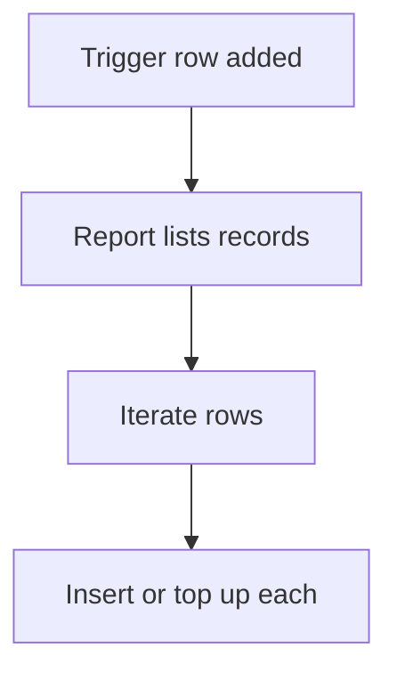

# Fan out rows from a report

## Task

One new row (policy, employee, payroll request) makes or tops up a row for every matching record.

## How

- Workflow on insert-after of the trigger row.
- executeReport to list the matching records.
- Iterate the report grid; query for an existing row.
- Insert a new row, or add to its log number field.

## Workaround

No for policy and employee seeding. Payroll uses a request sheet as the trigger, a stand-in for a bulk create step.

## Limits

- Large lists run long in one workflow.
- Re-running the trigger needs a guard against doubles.

## Flowchart

