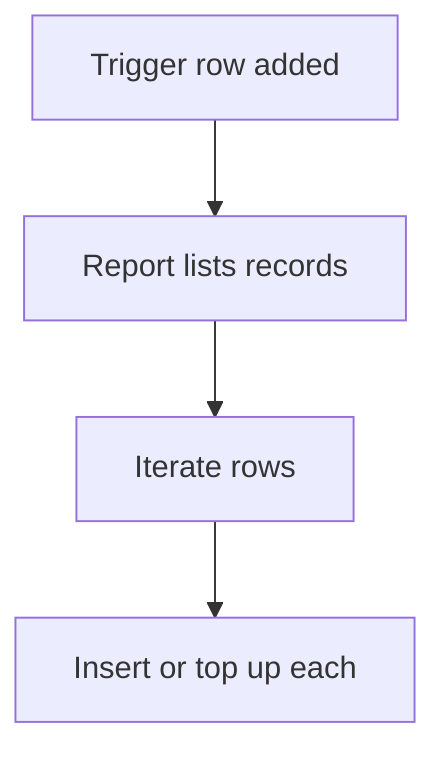

# Fan out rows from a report

## Task

One new row (policy, employee, payroll request) makes or tops up a row for every matching record.

## How

- Workflow on insert-after of the trigger row.
- executeReport to list the matching records.
- Iterate the report grid; query for an existing row.
- Insert a new row, or add to its log number field.

## Workaround

No for policy and employee seeding. Payroll uses a request sheet as the trigger, a stand-in for a bulk create step.

## Limits

- Large lists run long in one workflow.
- Re-running the trigger needs a guard against doubles.

## Flowchart

## Execute

Only use this to apply this into a Studio Enterprise via MCP.

Placeholders: TriggerSheet, SourceSheet, TargetSheet, MatchReport, FanOutWf. Needs first: the three sheets.

1. Report: output form `MatchOut` → `kind=composite type=grid name=Rows` + fields → `kind=gridLayout kind=table showComps=[…]` → `kind=formLayout type=content rootLayout=true` → `kind=var kind=mapping` (`toGrid=Rows`) → `add kind=report kind=spreadsheet fromSpreadsheet=SourceSheet outputFormMapping=<Map> filterCondition{cond}`.
2. Top-up variant: `type=logNumber` field on TargetSheet's form.
3. Workflow: `add kind=workflow name=FanOutWf` (nodeMap, edgeMap, noteMap, regionMap `{}`).
4. Nodes: `kind=eventSsInsertAfter spreadsheet=TriggerSheet` → `kind=executeReport report=MatchReport outputParamName=Match` → `kind=branchIterateGrid grid=Rows` → `kind=ssSearchRows spreadsheet=TargetSheet filterCondition` (verify: describe) → `kind=branchIfElse option=Condition` (found?).
5. FALSE: `kind=paramUpdate option=Mapping` → `kind=rowInsert spreadsheet=TargetSheet` (apply PAT-insert-row-in-other-sheet Execute). TRUE: `kind=rowUpdateFieldLogNumber operation=add inputField outputLogNumberField`.
6. `set kind=workflow edgeMap`: NEXT chain; iterate ITERATE → body, NEXT → end; branch TRUE/FALSE; body last node NEXT back to iterate.
7. `validate` till ok=true.

Gaps: passing the trigger row into executeReport not in guide; how to test ssSearchRows result unverified; edgeMap entry keys unverified; no guard against double runs.
