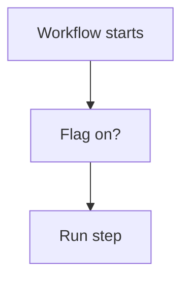

# Feature flag by variable

## Task

Switch a workflow step on or off without editing the flow.

## How

- Bool variable.
- branchIfElse on the variable at the start of the step.

## Workaround

Yes. No settings screen for a flow; a variable checked in a branch stands in.

## Limits

- Changing the variable is still a builder edit.

## Flowchart

