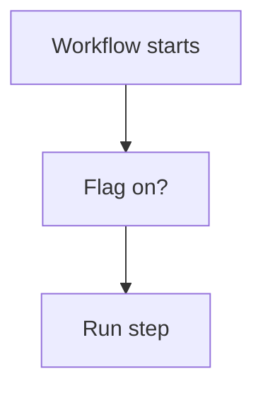

# Feature flag by variable

## Task

Switch a workflow step on or off without editing the flow.

## How

- Bool variable.
- branchIfElse on the variable at the start of the step.

## Workaround

Yes. No settings screen for a flow; a variable checked in a branch stands in.

## Limits

- Changing the variable is still a builder edit.

## Flowchart

## Execute

Only use this to apply this into a Studio Enterprise via MCP.

Placeholders: FlagStepOn, <Wf>, <StepNode>. Needs first: the workflow and its step.

1. Var: `add kind=var kind=bool name=FlagStepOn deploy=fixedOnDeploy value={value:true}`.
2. Node: `add kind=node parent=<Wf> kind=branchIfElse option=Condition condition={statement{lhs, operator:equalTo, rhs}}`, lhs/rhs = variable binder on FlagStepOn (verify: describe).
3. `set kind=workflow edgeMap`: node before → branch NEXT; TRUE → StepNode; FALSE → node after the step.
4. `validate` till ok=true.

Gaps: condition lhs on a var (variable binder) shape unverified; ConditionVar not usable via MCP, use inline Condition.
