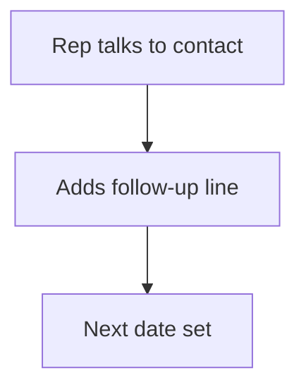

# Follow-up log on a record

## Task

Log dated follow-ups or remarks against a lead or other record.

## How

- Grid of date and remarks on the record, or a follow-up sheet with refTarget to any row.
- Formula copies the target name.

## Workaround

No. Direct feature (grid or refTarget).

## Limits

- Grid logs are not reportable across records as easily as a sheet.

## Flowchart

